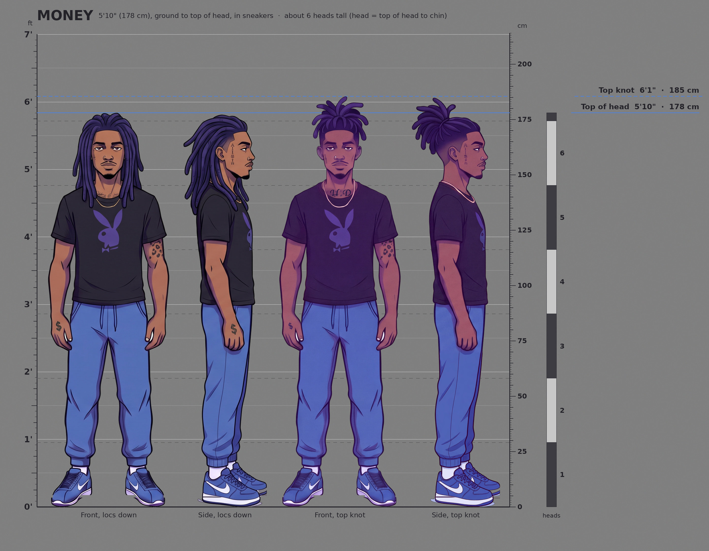

# Toonville

Toonville is an anime series. This repo holds its visual style guide: prompt blocks for characters and environments, and rules for how each scene reacts to the characters in it. [WORKFLOW.md](WORKFLOW.md) is the production workflow and checklist, from each character's sheets to every shot's stills.

## The style rule

Every Toonville prompt carries the established style, word for word, with no exceptions. That includes full prompts, short backups, edits and inpainting, one-line fixes, and anything sent to an image or video tool. This is what keeps every character, environment and prop consistent.

Every prompt is built in this order:

1. **Subject:** who or what, doing what, where. For a scene, add the story moment from the **reactive environment** table.
2. **Character style block:** for every character in the shot, their own block from the Characters section below. It covers their look, tattoos and outfit, with their skin and accent hex from the character table.
3. **Style block:** the block for the job, copied word for word.

| Job | Style block | The only edits allowed |
|---|---|---|
| Scenes and story shots | All-in-one block | Keep only the Night or Day line. Drop the "At story peaks" sentence for quiet scenes. |
| Character sheets | Character sheet block | Fill the description, expressions and hex slots. |
| Turnaround sheets with no expression row | Turnaround sheet block | Fill the description and hex slots. |
| Headshot turnaround sheets | Headshot sheet block | Fill the description and hex slots. |
| Single medium shots on a plain background | Medium shot block | Fill the description, pose and expression, and hex slots. |
| Single action medium shots on a plain background, with a glowing power | Action medium shot block | Fill the description, pose and expression, glow source and hex slots. |
| Object sheets for a character's objects | Object sheet block | Fill the object description, character name and hex slots. |
| Environments and props with no character | All-in-one block | Delete the Characters line. Keep only the Night or Day line. |
| Edits and inpainting on existing art | Edit block | Fill the hex slots. For background-only edits, swap the Characters line as its notes say. |

Every one of those blocks opens with the **master style line**, so it appears in every prompt:

```
Style: 90s cel anime with comic-book inking, fine film grain. Core palette: navy #09102E, deep teal #084558, cobalt #2F91DB, violet #5251B9, cloud white #DEE7E8.
```

No prompt rewords, shortens or drops style wording. A style change happens only when it's asked for, and it goes into this README first.

The character, night and day blocks further down are reference copies that spell out the same rules in more detail. Prompts use the blocks in the table above.

## All-in-one block

One block (197 words) that merges the character block, both environment blocks and the reactive rule. Before using it:

- Delete the **Night** or **Day** line you don't need. If both stay in, most generators blend them into a muddled dusk scene.
- Replace `[SKIN HEX]` and `[ACCENT HEX]` with the character's colours from the character table below.

The separate blocks further down hold the same rules in more detail.

```
Style: 90s cel anime with comic-book inking, fine film grain. Core palette: navy #09102E, deep teal #084558, cobalt #2F91DB, violet #5251B9, cloud white #DEE7E8.
Characters: bold black ink #030308, thick tapered contours, thin interiors, hatched shadows; flat cel colour, one or two hard-edged shadow tones, solid spotted blacks; skin [SKIN HEX]; signature accent [ACCENT HEX]. Characters alone own pure black, top highlights, accent.
Environment: thin tinted lines, never black, light hatching; slightly desaturated; dense detail at edges, open space around the character; three hazy depth layers. Its main light becomes the character's rim light; bloom only on glowing sources. At story peaks, signs, reflections and haze take on the accent.
Camera: wide angle, low or aerial, foreshortened hands; background matches the shot.
Night: dark teal lines #031E1C, mid-to-dark values; hot accents only on signs and lamps; neon glows in glass and haze; rain as thin straight white streaks; wet pavement mirrors neon in long vertical smears.
Day: navy lines #344481, light-to-mid values; sky cobalt #3572C5, bright blue #4A97CF, haze blue #91B8D5, concrete grey #909BA8, sage green #9CD086, roof brown #573931; high sun, hard cast shadows, loose painterly clouds on flat sky; glass glints, banners and leaves react.
```

## Character sheet block

For turnaround sheets that keep a character consistent across shots. Replace `[CHARACTER DESCRIPTION]`, the three expressions, `[SKIN HEX]` and `[ACCENT HEX]`.

It differs from the story blocks on purpose: a straight eye-level camera (wide-angle and low or aerial shots distort proportions), one even light that matches in every view, and a flat mid grey `#808080` background with no scenery, labels or captions. Mid grey is the default background for every character sheet, including the turnaround and headshot sheet blocks below. It says "no labels or captions" rather than "no text", because generators read "no text" as no lettering anywhere and can erase tattoos and clothing logos.

```
Character turnaround sheet of [CHARACTER DESCRIPTION]. Front, three-quarter, side and back views, full body, same height and scale, aligned on one ground line, relaxed neutral standing pose. Row of three expression close-ups: [EXPRESSION 1], [EXPRESSION 2], [EXPRESSION 3]. Flat mid grey #808080 background, no scenery, no labels or captions.
Style: 90s cel anime with comic-book inking, fine film grain. Core palette: navy #09102E, deep teal #084558, cobalt #2F91DB, violet #5251B9, cloud white #DEE7E8.
Character: bold black ink #030308, thick tapered contours, thin interiors, hatched shadows; flat cel colour, one or two hard-edged shadow tones, solid spotted blacks; skin [SKIN HEX]; signature accent [ACCENT HEX].
Lighting: even light from upper left, identical in every view, no bloom.
Camera: eye level, long lens, no perspective distortion.
```

## Turnaround sheet block

For full-body turnarounds without the expression row, so heads never overlap the standing views. Replace `[CHARACTER DESCRIPTION]`, `[SKIN HEX]` and `[ACCENT HEX]`.

It's the character sheet block with one change, asked for: the row of expression close-ups is removed. Every other word is the same.

```
Character turnaround sheet of [CHARACTER DESCRIPTION]. Front, three-quarter, side and back views, full body, same height and scale, aligned on one ground line, relaxed neutral standing pose. Flat mid grey #808080 background, no scenery, no labels or captions.
Style: 90s cel anime with comic-book inking, fine film grain. Core palette: navy #09102E, deep teal #084558, cobalt #2F91DB, violet #5251B9, cloud white #DEE7E8.
Character: bold black ink #030308, thick tapered contours, thin interiors, hatched shadows; flat cel colour, one or two hard-edged shadow tones, solid spotted blacks; skin [SKIN HEX]; signature accent [ACCENT HEX].
Lighting: even light from upper left, identical in every view, no bloom.
Camera: eye level, long lens, no perspective distortion.
```

## Headshot sheet block

For head-and-shoulders turnarounds that keep a character's face, hair and face tattoos consistent. Replace `[CHARACTER DESCRIPTION]`, `[SKIN HEX]` and `[ACCENT HEX]`.

It's the character sheet block with one change, asked for: head-and-shoulders views instead of full body. Every style line is the same, word for word, including the mid grey background.

```
Headshot turnaround sheet of [CHARACTER DESCRIPTION]. Front, three-quarter, side and back views of the head and shoulders, same size and scale, eyes aligned on one level, relaxed neutral expression. Flat mid grey #808080 background, no scenery, no labels or captions.
Style: 90s cel anime with comic-book inking, fine film grain. Core palette: navy #09102E, deep teal #084558, cobalt #2F91DB, violet #5251B9, cloud white #DEE7E8.
Character: bold black ink #030308, thick tapered contours, thin interiors, hatched shadows; flat cel colour, one or two hard-edged shadow tones, solid spotted blacks; skin [SKIN HEX]; signature accent [ACCENT HEX].
Lighting: even light from upper left, identical in every view, no bloom.
Camera: eye level, long lens, no perspective distortion.
```

## Medium shot block

For a single shot of one character framed from the waist up, on the same plain background as the sheets. Replace `[CHARACTER DESCRIPTION]`, `[POSE AND EXPRESSION]`, `[SKIN HEX]` and `[ACCENT HEX]`. In the pose, say which way the character turns, so features that must stay on one side (like Money's face tattoo) face the camera.

Its style lines are the sheet blocks' lines, word for word: one even light, an eye-level long-lens camera and flat mid grey `#808080`. A medium shot set in a place uses the all-in-one block instead.

```
Medium shot of [CHARACTER DESCRIPTION]. Single figure, framed from the waist up, [POSE AND EXPRESSION]. Flat mid grey #808080 background, no scenery, no labels or captions.
Style: 90s cel anime with comic-book inking, fine film grain. Core palette: navy #09102E, deep teal #084558, cobalt #2F91DB, violet #5251B9, cloud white #DEE7E8.
Character: bold black ink #030308, thick tapered contours, thin interiors, hatched shadows; flat cel colour, one or two hard-edged shadow tones, solid spotted blacks; skin [SKIN HEX]; signature accent [ACCENT HEX].
Lighting: even light from upper left, identical in every view, no bloom.
Camera: eye level, long lens, no perspective distortion.
```

## Action medium shot block

For a single action shot of one character framed from the waist up, on the same plain background as the sheets, while one of their powers glows: for example, Money charging his plasma. Replace `[CHARACTER DESCRIPTION]`, `[POSE AND EXPRESSION]`, `[GLOW SOURCE]`, `[SKIN HEX]` and `[ACCENT HEX]`. In the pose, say which way the character turns, as in the medium shot block, and which hand holds what.

It's the medium shot block with one change, asked for: the lighting line lets the power glow with bloom and rim-light the character, because glowing sources get bloom and their light becomes the rim light. Every other line is the same, word for word, including the mid grey `#808080` background and the eye-level camera.

```
Medium shot of [CHARACTER DESCRIPTION]. Single figure, framed from the waist up, [POSE AND EXPRESSION]. Flat mid grey #808080 background, no scenery, no labels or captions.
Style: 90s cel anime with comic-book inking, fine film grain. Core palette: navy #09102E, deep teal #084558, cobalt #2F91DB, violet #5251B9, cloud white #DEE7E8.
Character: bold black ink #030308, thick tapered contours, thin interiors, hatched shadows; flat cel colour, one or two hard-edged shadow tones, solid spotted blacks; skin [SKIN HEX]; signature accent [ACCENT HEX].
Lighting: even light from upper left; [GLOW SOURCE] is the only glowing source, with bloom, and its colour becomes the character's rim light on the side facing it.
Camera: eye level, long lens, no perspective distortion.
```

## Object sheet block

For the objects that belong to one character: things they carry, wear, use or are known by. Each object gets its own sheet, so it looks the same in every shot. Replace `[OBJECT DESCRIPTION]`, `[CHARACTER NAME]`, `[SKIN HEX]` and `[ACCENT HEX]`. The description comes from the object list in the owner's entry: what the object is, what it's made of, its colours as hex codes and its real size in cm. The owner's hand appears in one view, so the prompt carries their character style block too, after the subject.

Its style lines are the sheet blocks' lines, word for word: the character ink, skin and accent line, one even light, an eye-level long-lens camera and flat mid grey `#808080`. Objects that stay in one place are part of that location's sheet instead.

```
Object sheet of [OBJECT DESCRIPTION], belonging to [CHARACTER NAME]. Front, side, back and top views of the object alone, same scale, aligned on one ground line, plus one view of it held in [CHARACTER NAME]'s hand to show its size. Flat mid grey #808080 background, no scenery, no labels or captions.
Style: 90s cel anime with comic-book inking, fine film grain. Core palette: navy #09102E, deep teal #084558, cobalt #2F91DB, violet #5251B9, cloud white #DEE7E8.
Character: bold black ink #030308, thick tapered contours, thin interiors, hatched shadows; flat cel colour, one or two hard-edged shadow tones, solid spotted blacks; skin [SKIN HEX]; signature accent [ACCENT HEX].
Lighting: even light from upper left, identical in every view, no bloom.
Camera: eye level, long lens, no perspective distortion.
```

## Edit block

For edits and inpainting on existing Toonville art: write the edit first (what to change, and where), then the character style block for anyone being edited, then this block. For an edit that touches only the background, replace the Characters line with the all-in-one block's Environment line and its Night or Day line.

```
Style: 90s cel anime with comic-book inking, fine film grain. Core palette: navy #09102E, deep teal #084558, cobalt #2F91DB, violet #5251B9, cloud white #DEE7E8.
Characters: bold black ink #030308, thick tapered contours, thin interiors, hatched shadows; flat cel colour, one or two hard-edged shadow tones, solid spotted blacks; skin [SKIN HEX]; signature accent [ACCENT HEX]. Characters alone own pure black, top highlights, accent.
Outside the edited area, keep the image exactly as it is: same layout, lighting, camera, line weight and colours.
```

Some existing sheets drift from the style, with thinner lines, softer shading and a violet cast. An edit that carries this block can come out slightly bolder than the art around it. New sheets generated with the full style block avoid that.

## Character block

Reference copy of the character rules. Prompts use the blocks in the style rule table, which already contain them.

```
90s cel anime with comic-book inking. Line work: bold black ink #030308, thick tapered contours, thin interiors, hatched shadows. Palette: navy #09102E, deep teal #084558, cobalt #2F91DB, violet #5251B9, cloud white #DEE7E8, plus the character's skin tone [SKIN HEX] and signature accent [ACCENT HEX]. Shading: flat cel colour, one or two hard-edged shadow tones, solid spotted blacks. Lighting: one strong source, crisp rim light; bloom only on glowing sources like neon, visors, energy. Texture: fine even film grain. Camera: wide angle, low or aerial, hands foreshortened toward the lens.
```

## Character table

Each main character has their own height, skin tone and one signature accent colour. The height sets their size on the [size chart](#size-chart). The skin tone fills `[SKIN HEX]`. The accent fills `[ACCENT HEX]`; it appears on the character and is the colour the environment picks up when it reacts to them.

| Character | Height | Skin tone | Accent name | Accent hex |
|---|---|---|---|---|
| Money | 5'10" (178 cm) | Deep brown `#9B7461` | Royal blue | `#5381D4` |
| _TBD_ | _TBD_ | _TBD_ | _TBD_ | `#______` |
| _TBD_ | _TBD_ | _TBD_ | _TBD_ | `#______` |
| _TBD_ | _TBD_ | _TBD_ | _TBD_ | `#______` |

## Characters

Every character has their own **character style block**: their look, tattoos and outfits, written to fill `[CHARACTER DESCRIPTION]` and to go in front of the style block in every prompt that shows them. Each character entry holds:

- a row in the character table, with height, skin tone and accent colour
- profile notes: colours, hair, face, tattoos and outfits
- their character style block
- a sheet note, if they have features that must stay on one side
- a short backup of their character style block
- a sheet for each outfit and hairstyle in `characters/<name>/`, named `<name>-<outfit>-<hairstyle>.jpg` (for example `-hair-up` or `-hair-down`), with any known differences listed
- a list of the objects that belong to them, with an object sheet for each in `characters/<name>/objects/`

### Money

A young man in his early 20s. Tone: understated and grounded, with realistic proportions, a calm heavy-lidded gaze and restrained detail.

- **Main outfit with jacket, hair up:** [`characters/money/money-main-outfit-jacket-hair-up.jpg`](characters/money/money-main-outfit-jacket-hair-up.jpg), his main outfit as worn in most shots, with the grey bomber jacket open and his hair tied up: front, three-quarter, side view facing right, side view facing left, and back, on mid grey `#808080` (made with the turnaround sheet block, then fixed by hand). It's canon for the jacket outfit, the face tattoo on his right temple (bare left side), the "$" on his right hand, and where the retracted golden rod sits: at his left hip. Exceptions, where the written rules here win:
  - **Golden rod:** painted in by hand. The generator put it in his right hand, so it was painted out, and the retracted rod was placed at his left hip in the front, left-facing side and back views. In the three-quarter and right-facing side views his body hides it. Its top diamond sits in front of the jacket hem, not tucked under it.
  - **Face tattoo lettering:** garbled in every view. It reads A, l, l, $, I, n. The left-facing view had it on his left temple, so it was painted out there.
  - **Hair:** the locs are wound into a tight bun. His high top knot is looser, with the locs fanning up and out.
  - **Side-view sneakers:** chunkier than the slim Cortez in the other views.
  - **Colours:** the jacket reads darker and violet-tinted, so use `#C2C2C2` and the other hex codes listed here.
  - **Repaint traces:** close up, his right hand in the back view has a straight left edge, and the front view's jacket panel has a lighter patch where the rod's top diamond was.
- **Main outfit with jacket, hair down:** [`characters/money/money-main-outfit-jacket-hair-down.jpg`](characters/money/money-main-outfit-jacket-hair-down.jpg), the same jacket turnaround with his locs falling loose past his shoulders: front, three-quarter, side view facing right, side view facing left, and back, on mid grey `#808080` (made with the turnaround sheet block, then fixed by hand). It's canon for the jacket outfit with his hair down, the face tattoo on his right temple (bare left side), the "$" on his right hand, and the retracted golden rod at his left hip. Exceptions, where the written rules here win:
  - **Golden rod:** painted in by hand, as on his hair-up jacket sheet: at his left hip in the front, left-facing side and back views, hidden by his body in the three-quarter and right-facing side views, with its top diamond in front of the jacket hem.
  - **Face tattoo:** faint marks in the front view, because his face is too small at this sheet size, and garbled in the three-quarter and right-facing views. It reads A, l, l, $, I, n.
  - **Side-view sneakers:** chunkier than the slim Cortez in the other views.
  - **Colours:** the jacket reads darker and violet-tinted, so use `#C2C2C2` and the other hex codes listed here.
  - **Repaint traces:** close up, his right hand in the back view has a straight left edge.
- **Main outfit, hair up:** [`characters/money/money-main-outfit-hair-up.jpg`](characters/money/money-main-outfit-hair-up.jpg), his official main-outfit turnaround with his hair tied up: front, three-quarter, side view facing right, side view facing left, and back. It's canon for his look, his outfit and where his tattoos sit: the face tattoo on his right temple, the "$" on his right hand, the leopard print below his left sleeve, and the tops of "High Power" above the collar in the front view. Exceptions, where the written rules here win:
  - **Nose rings:** each view shows one ring. He has one in each nostril.
  - **Face tattoo lettering:** a little garbled in the front view. It reads A, l, l, $, I, n.
  - **"High Power" at the collar:** reads as just the capitals H and P. The placement is right.
  - **Side-view sneakers:** chunkier than the slim Cortez in the other views.
  - **Colours:** the sheet has a violet cast, so use the hex codes listed here, not colours picked from the image.
- **Main outfit, hair down:** [`characters/money/money-main-outfit-hair-down.jpg`](characters/money/money-main-outfit-hair-down.jpg), his main-outfit turnaround with his locs falling loose past his shoulders: front, three-quarter, side view facing right, side view facing left, and back (made with the turnaround sheet block). It's canon for his hair down, his outfit and where his tattoos sit: the face tattoo on his right temple, the "$" on his right hand, the leopard print below his left sleeve, and the tops of "High Power" above the collar in the front view. Exceptions, where the written rules here win:
  - **Front-view face tattoo:** shows as faint marks, because his face is too small at this sheet size for the lettering to read. It reads A, l, l, $, I, n, clearly visible in the three-quarter and right-facing views.
  - **Side-view sneakers:** chunkier than the slim Cortez in the other views.
- **Main outfit shirtless, hair up:** [`characters/money/money-main-outfit-shirtless-hair-up.jpg`](characters/money/money-main-outfit-shirtless-hair-up.jpg), his official shirtless asset: the shirtless tattoo-reference outfit with his hair tied up, in front, three-quarter, side (facing left) and back views. It's canon for his build (with slight ab definition on the front and three-quarter views), his nose rings, and where every tattoo sits. In the side view, "Power" wraps across his left pec, and the leopard print covers his left upper arm in every view. Exceptions, where the written rules here win:
  - **Face tattoo lettering:** garbled in the three-quarter view. It reads A, l, l, $, I, n.
  - **"High Power" lettering:** plainer than his real ornate script. The placement is right.
  - **Colours:** like his main outfit sheet, it has a violet cast, so use the hex codes listed here.
- **Main outfit shirtless, hair down:** [`characters/money/money-main-outfit-shirtless-hair-down.jpg`](characters/money/money-main-outfit-shirtless-hair-down.jpg), the shirtless tattoo-reference outfit with his locs falling loose past his shoulders, in front, three-quarter, side (facing left) and back views (made with the turnaround sheet block). It's canon for his hair down shirtless, his build (with slight ab definition on the front and three-quarter views), his nose rings, and where every tattoo sits: the face tattoo on his right temple, reading A, l, l, $, I, n in the three-quarter view; "High Power" across his upper chest with the Eye of Horus below; the "$" on his right hand; and the leopard print on his left upper arm in every view. In the side view, his bare left temple faces the camera and "Power" shows across his chest. Exceptions, where the written rules here win:
  - **Front-view face tattoo:** shows as faint marks, because his face is too small at this sheet size for the lettering to read. It's on the correct temple.
  - **"High Power" lettering:** plainer than his real ornate script, without the swashes beneath. The placement is right.
  - **Colours:** his skin reads a little lighter and rosier than canon, so use the hex codes listed here.
- **Headshots, hair up:** [`characters/money/money-headshots-hair-up.jpg`](characters/money/money-headshots-hair-up.jpg), his head-and-shoulders turnaround in his main outfit: front, three-quarter, side and back, on mid grey `#808080` (made with the headshot sheet block). It's canon for his face, the face tattoo on his right temple (bare left side), his nose rings and chain. Exceptions, where the written rules here win:
  - **Hair:** the locs are wound into a tight bun. His high top knot is looser, with the locs fanning up and out.
  - **"High Power":** both full words show above a lower neckline. In his main outfit, only the tops of the lettering peek above the crew-neck collar.
- **Headshots, hair down:** [`characters/money/money-headshots-hair-down.jpg`](characters/money/money-headshots-hair-down.jpg), his head-and-shoulders turnaround in his main outfit with his locs falling loose past his shoulders: front, three-quarter, side and back, on mid grey `#808080`. It's his hair-up headshots with only the hair changed (an edit made with the edit block), so his face, the face tattoo on his right temple (bare left side), his nose rings and chain are the same. It's canon for his hair down from the head and shoulders, with the faded sides showing in the three-quarter and side views. Exceptions, where the written rules here win:
  - **"High Power":** both full words show above a lower neckline, as in his hair-up headshots. In his main outfit, only the tops of the lettering peek above the crew-neck collar.
- **Medium shot, main outfit, hair up:** [`characters/money/money-medium-shot-main-outfit-hair-up.jpg`](characters/money/money-medium-shot-main-outfit-hair-up.jpg), a single shot in his main outfit with his hair up, framed from the waist up and turned slightly toward the viewer's right, on mid grey `#808080` (made with the medium shot block). The generator mirrored him, so the shot was flipped and his tattoos were put back where they belong. It's canon for how he looks in a single shot: the face tattoo on his right temple in front of his ear, reading A, l, l, $, I, n; the "$" on the back of his right hand; the leopard print below his left sleeve; a nose ring in each nostril; and his chain. Exceptions, where the written rules here win:
  - **"High Power":** most of both words show above a lower neckline. In his main outfit, only the tops of the lettering peek above the crew-neck collar.
  - **Hand tattoo:** the "$" doesn't show the two short ticks across its lower curve.
- **Front view, main outfit, hair up:** [`characters/money/money-front-view-main-outfit-hair-up.jpg`](characters/money/money-front-view-main-outfit-hair-up.jpg), the front view from his hair-up main-outfit sheet on its own, full body and centred, at the medium shot's size (1792×2400) on mid grey `#808080`. It's cut from that sheet at full resolution, with the sheet's ground line taken out, so it's canon for the same things and carries the same exceptions, where the written rules here win:
  - **Nose rings:** only one ring shows. He has one in each nostril.
  - **Face tattoo lettering:** a little garbled. It reads A, l, l, $, I, n.
  - **"High Power" at the collar:** reads as just the capitals H and P. The placement is right.
  - **Colours:** the violet cast of that sheet, so use the hex codes listed here.
- **Close-ups, hair up:** [`money-close-up-glare-hair-up.jpg`](characters/money/money-close-up-glare-hair-up.jpg), [`money-close-up-smirk-hair-up.jpg`](characters/money/money-close-up-smirk-hair-up.jpg) and [`money-close-up-calm-hair-up.jpg`](characters/money/money-close-up-calm-hair-up.jpg) in `characters/money/`, his three default expressions as head close-ups, each centred at 1792×2400 on mid grey `#808080`. They're cut at full resolution from the expression row of his first hair-up sheet. The glare and smirk turn toward the viewer's right with the face tattoo on his right temple, and the calm look turns toward the viewer's left, showing his bare left temple. They're canon for his expressions and his face from close up. Exceptions, where the written rules here win:
  - **Nose rings:** the glare and smirk show one small gold stud, and the calm look shows none. He has a small gold ring in each nostril.
  - **Collar:** a white collar band shows at the neck, and "High Power" doesn't show. His main outfit is a black crew-neck T-shirt with the tops of the lettering just above the collar.
  - **Colours:** they lean rosy and violet, so use the hex codes listed here.
- **Colours:** skin `#9B7461`, accent `#5381D4` (royal blue, sampled from the cap in his reference photos, and the colour of his jacket lining), locs `#2F1958` (deep indigo-violet, with shadow `#1E083C` and highlight `#422D7A`), gold `#CEAF81` (chain, nose rings and golden rod), jacket `#C2C2C2` (light grey), plasma `#6F00FF` (electric indigo).
- **Height:** 5'10" (178 cm), from the ground to the top of his head, in his sneakers, with his locs down. His top knot reaches about 6'1" (185 cm). He's about 6 heads tall, counting a head from the top of his head to his chin, and his eye line sits at about 162 cm. All of it is measured on his canon sheets and drawn on the [size chart](#size-chart).
- **LoRA:** trigger word `mnytoon`, with a 30-image training set in [`characters/money/lora/`](characters/money/lora/). See [LoRA training](#lora-training). Base model and training settings: _TBD_, to be recorded here once it's trained.
- **Objects:** he keeps many stolen artifacts. Each one gets an entry here and an object sheet in `characters/money/objects/`.
  - **Golden rod:** a stolen artifact, and his weapon. It's a telescoping staff of polished gold `#CEAF81`, the same gold as his chain.
    - **Size:** 150 cm long extended, reaching about his chin, and 30 cm retracted.
    - **Look:** the top third is encrusted with clear faceted diamonds and ends in a large faceted diamond tip. A matching large faceted diamond forms the end cap at the bottom.
    - **Carried:** retracted, tucked into his waistband at his left hip or inside his open jacket. He holds it and fires through it with his left hand, the leopard-print arm.
    - **Use:** he fights with it extended, and channels his plasma through its diamond tip (see Powers).
    - **Object sheets:** `money-golden-rod-extended.jpg` and `money-golden-rod-retracted.jpg`, still to be made.
  - **Balaclava:** a dark navy knit balaclava by Supreme, made with New Era, that he pulls over his whole head, face and neck. It hides his hair completely, so only his eyes show.
    - **Colours:** dark navy `#262737` knit with white `#E3E1F0` lettering, sampled from the product photo after converting it from Display P3 to sRGB.
    - **Look:** rows of the white "Supreme" wordmark in chunky italic knit letters repeat all the way around it in horizontal bands, offset from row to row. One wide rounded eye opening runs across both eyes. A small white New Era flag logo sits on its left side, just below the eye opening, which is the viewer's right in a front view. It ends in a plain navy ribbed hem at the base of the neck.
    - **Size:** one size, fitted close to his head, running from the crown to the ribbed hem at the base of his neck.
    - **Worn:** pulled all the way down, with its neck bunched in soft folds above his collar. For prompts, use the balaclava swap under his character style block.
    - **Object sheet:** `money-balaclava.jpg`, still to be made.
- **Powers:** he channels his energy into electric indigo `#6F00FF` plasma beams, fired from his hands or from the golden rod's diamond tip. The plasma is a glowing source, so it gets bloom. While he fires it, it's the main light on him: it becomes his rim light and lights the scene around him.
- **Accent note:** royal blue is on trial. Its hue sits between the core palette's cobalt and violet, so check night scenes in particular to see whether he still stands out from the background when the environment picks up his accent.
- **Hair:** deep indigo-violet locs all over, not just highlights, with faded sides and back. Worn two ways: gathered into a high top knot, or falling loose past his shoulders.
- **Face:** warm brown eyes with dark lashes, thin mustache and short chin beard, a small gold nose ring in each nostril.
- **Face tattoo, "All $ In" (right side only):** six small hand-lettered characters stacked upright in a vertical column. Top to bottom they read capital `A`, lowercase `l`, lowercase `l`, `$`, capital `I` with serifs (which tells it apart from the `l`s), lowercase `n`. Clean, thin, evenly spaced print in muted indigo-violet ink. The column starts at his right temple at about eyebrow height, and runs down the front edge of his sideburn hairline to about earlobe height, just in front of his ear. The left side of his face is bare.
- **Chest tattoo, "High Power":** large ornate cursive script, with tall flourished capitals `H` and `P` and swashes under the words, in faded grey-black ink. It runs across his upper chest just below the collarbones. "High" sits on his right pec, which is the viewer's left in a front view, and "Power" crosses the sternum toward his left pec. In his main outfit, the crew-neck T-shirt covers most of it, but the tops of the lettering peek just above the front of the collar, so his character style block includes that. Any outfit that shows his chest must include the full chest tattoo text from the shirtless outfit below.
- **Chest piece, Eye of Horus:** a large outlined Eye of Horus, in the same faded grey-black ink, under "High Power". It's centred on his chest and reaches toward the top of his stomach. Like "High Power", it's hidden by his T-shirt and lives in the shirtless outfit text. Ignore the script near his left pec; it isn't part of his design.
- **Arm tattoo, leopard print:** open rosettes and solid spots in faded black ink, covering his left upper arm. It starts at the shoulder cap, runs down the outer arm and stops above the elbow. His left arm is the viewer's right in a front view. In his main outfit, the jacket's sleeves cover it. With the jacket off, the part below the T-shirt sleeve shows in every view where that arm is visible, so it's in his jacket-off outfit text.
- **Hand tattoo:** a small, bold, hand-drawn black-ink "$" with a single vertical stroke through it, and two short ticks crossing its lower curve. It sits on the back of his right hand, nearer the wrist than the knuckles.
- **Outfits:**
  - **Main (worn in most shots):** a light grey bomber jacket `#C2C2C2` worn open, with a ribbed knit collar, cuffs and hem, a front zip and royal blue lining `#5381D4`, over a black Playboy T-shirt; cuffed blue Polo jogger sweatpants, white socks, blue Nike Cortez sneakers with a white swoosh and white soles; his small thin gold chain; and his retracted golden rod at his left hip. The jacket's sleeves cover his leopard print. Its sheets are his jacket turnarounds, `money-main-outfit-jacket-hair-up.jpg` and `money-main-outfit-jacket-hair-down.jpg`. His other main-outfit sheets, headshots, medium shot, front view and close-ups all show it with the jacket off.
  - **Main, jacket off (as on his main outfit sheets):** the same outfit without the jacket, so the leopard print shows below the T-shirt's left sleeve. Swap it in by replacing everything after `main outfit:` in his description with this:

    ```
    black Playboy T-shirt, with the lower part of the leopard print showing below the left sleeve and the tops of his ornate grey-black cursive "High Power" chest tattoo peeking just above the front of the collar; his retracted golden rod, 30 cm of polished gold with a diamond-encrusted top and a large faceted diamond at each end, tucked into his waistband at his left hip; cuffed blue Polo jogger sweatpants, white socks, blue Nike Cortez sneakers with a white swoosh and white soles
    ```

  - **Main, in action (rod extended in his left hand):** the main outfit with the jacket, for fight and power shots, with his golden rod extended to 150 cm in his left hand instead of retracted at his hip. Swap it in by replacing everything after `main outfit:` in his description with this:

    ```
    light grey bomber jacket #C2C2C2 worn open, with a ribbed knit collar, cuffs and hem, a front zip and royal blue lining #5381D4, its long sleeves covering the leopard print; under it a black Playboy T-shirt, with the tops of his ornate grey-black cursive "High Power" chest tattoo peeking just above the front of the collar; his golden rod extended to 150 cm in his left hand, a telescoping staff of polished gold #CEAF81 with its top third encrusted with clear faceted diamonds, ending in a large faceted diamond tip, and a matching large faceted diamond end cap at the bottom; cuffed blue Polo jogger sweatpants, white socks, blue Nike Cortez sneakers with a white swoosh and white soles
    ```

  - **Shirtless (tattoo reference, as on his main outfit shirtless sheet):** no shirt, so the chest tattoo shows, with his main outfit's joggers, socks and sneakers. Use it for a tattoo reference sheet. Swap it in by replacing everything after `main outfit:` in his description with this:

    ```
    shirtless, showing his "High Power" chest tattoo: large ornate cursive script with tall flourished capital H and P and swashes beneath, in faded grey-black ink, running across his upper chest just below the collarbones, "High" on his right pec (the viewer's left in the front view) and "Power" crossing the sternum toward his left pec; below it, a large outlined Eye of Horus in the same faded grey-black ink, centred on his chest and reaching toward the top of his stomach; cuffed blue Polo jogger sweatpants, white socks, blue Nike Cortez sneakers with a white swoosh and white soles
    ```

  - More outfits to come. Add each one here as its own bullet.

**Money's character style block** (fills `[CHARACTER DESCRIPTION]`), with his hair tied up and his main outfit. For hair down, replace `gathered into a high top knot` with `falling loose past his shoulders`. For another outfit, replace everything after `main outfit:` with that outfit. Everything that depends on the outfit, such as which tattoos show past a sleeve or collar, sits after `main outfit:`, so the swap stays clean.

```
Money, a young Black man in his early 20s: athletic lean build, grounded realistic proportions, long face with high cheekbones and a defined jaw, deep brown skin, warm brown eyes with dark lashes, calm heavy-lidded gaze, thin mustache and short chin beard; deep indigo-violet locs #2F1958 gathered into a high top knot, with faded sides and back; small gold nose ring in each nostril; face tattoo on the right side of his face only: six small hand-lettered characters stacked upright in a vertical column, reading top to bottom "A", "l", "l", "$", "I", "n" (All $ In), in clean, thin, evenly spaced print in muted indigo-violet ink, running from his right temple at eyebrow height down the front edge of his sideburn to earlobe height, just in front of his ear; the left side of his face is bare; small bold hand-drawn black-ink "$" tattoo with a single vertical stroke, on the back of his right hand near the wrist; leopard-print tattoo of open rosettes and spots in faded black ink covering his left upper arm (the viewer's right in the front view) from the shoulder cap down, stopping above the elbow; small thin gold chain #CEAF81; main outfit: light grey bomber jacket #C2C2C2 worn open, with a ribbed knit collar, cuffs and hem, a front zip and royal blue lining #5381D4, its long sleeves covering the leopard print; under it a black Playboy T-shirt, with the tops of his ornate grey-black cursive "High Power" chest tattoo peeking just above the front of the collar; his retracted golden rod, 30 cm of polished gold with a diamond-encrusted top and a large faceted diamond at each end, tucked into his waistband at his left hip; cuffed blue Polo jogger sweatpants, white socks, blue Nike Cortez sneakers with a white swoosh and white soles
```

**With his balaclava:** replace everything from `long face with high cheekbones` through `the left side of his face is bare;` with the text below. The balaclava hides his hair, face tattoo, nose rings, mustache and beard, so this replaces all of them, and the hair swap doesn't apply. The outfit swap still works as usual.

```
deep brown skin; his dark navy Supreme balaclava #262737 pulled over his whole head, face and neck, hiding his hair completely: rows of the white #E3E1F0 "Supreme" wordmark in chunky italic knit letters repeat all the way around it in horizontal bands, a small white New Era flag logo sits on its left side just below the eye opening (the viewer's right in a front view), and its neck is bunched in soft folds above his collar; one wide rounded eye opening shows only his warm brown eyes with dark lashes, his calm heavy-lidded gaze and the deep brown skin around them;
```

For character sheets, add this straight after the description so the face tattoo lands on the correct side in every view. Generators mix up "his left" and "his right", so the note uses directions relative to the viewer. Every turned view faces the viewer's right, which keeps his right temple toward the camera, so the tattoo is always on the visible side:

```
; in the front view the face tattoo is on his right temple, the viewer's left; the three-quarter view, the side view and all three expression close-ups face toward the viewer's right, so his right temple and the tattoo face the camera and his bare left temple is turned away
```

Generators often put the face tattoo on whichever temple faces the camera, or drop it, so check every view before accepting a new sheet.

Default sheet expressions: calm heavy-lidded stare, slight confident smirk, cold narrowed glare.

**Short backup of his character style block (163 words).** Use this only if a generator cuts off the full prompt, which shows up as a sheet missing the ink lines or flat cel shading, since the style lines come last. It replaces both the full description and the sheet note above, because the viewing directions are already built in. With the character sheet block it comes to 286 words, about 1,800 characters. For hair down, replace `in a high top knot` with `falling loose past his shoulders`.

It leaves out his face shape, the full "High Power" description, the jacket's collar, cuffs and zip, the rod's size, the socks, the swoosh and soles, and the hex codes for the chain, jacket and lining. It keeps everything that has gone wrong in past sheets: the tattoo letters and side, the viewing directions, his locs colour and the gold nose rings.

```
Money, a lean athletic young Black man in his early 20s: deep brown skin, calm heavy-lidded gaze, thin mustache and short chin beard; deep indigo-violet locs #2F1958 in a high top knot, faded sides; gold nose ring in each nostril; face tattoo on his right temple only, letters stacked top to bottom "A", "l", "l", "$", "I", "n" in thin indigo-violet ink, from eyebrow to earlobe, just in front of his ear; small "$" tattoo on the back of his right hand; leopard-print tattoo on his left upper arm, hidden by his jacket; thin gold chain; light grey bomber jacket worn open, royal blue lining, over a black Playboy T-shirt, with the top of the "High Power" chest script peeking above the collar; retracted gold rod with a diamond at each end at his left hip; cuffed blue Polo joggers, blue Nike Cortez sneakers; front view: face tattoo on the viewer's left; three-quarter view, side view and close-ups all face the viewer's right
```

## Size chart

[`characters/size-chart.jpg`](characters/size-chart.jpg) keeps every character's height and proportions consistent when they're placed into film. It shows each main character in front and side views on one ground line, against a feet-and-inches ruler, a centimetre ruler and head-unit lines. So far it holds Money.



- **How heights are measured:** from the ground to the top of the head, in the character's usual shoes, with the hair down. Anything that sits above the head, like Money's top knot, gets its own dashed line.
- **How the chart is made:** from each character's canon turnaround sheets, not generated, so the art and proportions stay exact. Each sheet is scaled so the character's height matches the rulers, at 9 px per cm. A sheet with a different hairstyle is scaled to the same eye height.
- **Adding a character:** once they have a height in the character table and a finished turnaround sheet, add their front and side views at their height, on the same scale and ground line, next to the others.
- **Using it in film:** in every shot, characters' heights relative to each other match the chart. When characters are composited into a scene, scale each one by their chart height, not by how big they were drawn on their own sheet.

## LoRA training

Each main character gets their own LoRA, trained on their canon art, so every generation keeps their face, hair and tattoos. The LoRA holds who the character is, and the style block still holds the Toonville look, so prompts carry both.

- **Training sets:** in `characters/<name>/lora/`. Every canon view sits on its own 1024×1024 mid grey square, with a caption file of the same name, and `captions.csv` lists them all. Money's set has 30 images, cut from his saved sheets, his medium shot and his three expression close-ups, with the trigger word `mnytoon`.
- **Never mirror:** turn off flip, mirror or horizontal-flip augmentation in the trainer. Money's face tattoo, "$" hand and leopard arm are one-sided, and mirrored copies would teach them on both sides.
- **Captions name only what changes:** view and facing direction, framing, hair, outfit, expression and background. What never changes stays out of the captions so it binds to the trigger word: for Money, his face, locs colour, tattoos, nose rings and chain. Known sheet differences are captioned, such as `tight bun` or `low neckline, chest tattoo text visible`, so they don't become part of him.
- **Colours:** sources with a violet cast are colour-matched to his hair-down sheets before training.
- **One base model:** train and generate on the same base model. A LoRA trained on one base generally won't work on another.
- **In a prompt:** select the LoRA at about 0.7–0.9 weight and start the subject with the trigger word. The character style block and the job's style block follow as usual.
- **Before trusting it:** generate a test set (front, three-quarter, side and back, hair up and hair down) and check it against canon. For Money that's the face tattoo on his right temple, a nose ring in each nostril, his locs colour, the "$" on his right hand and the leopard print on his left arm. Small lettering like "All $ In" and "High Power" rarely comes out clean, so plan to touch it up.

## Locations

Every location the story uses gets an entry here before any shot is made there, following step 4 of [WORKFLOW.md](WORKFLOW.md). Each entry holds:

- its name and what happens there
- day, night or both
- its main light source and that light's colour, which becomes the rim light of every character there
- where characters stand: the calm open area
- its reactive surfaces, such as signs, glass, puddles, banners and leaves
- its location sheets in `locations/<location>/`, with any known differences listed

No locations yet.

## Night environment block

Reference copy of the night rules. Prompts use the all-in-one block, which already contains them.

```
Night environment layer, same style. Line work: thin lines in dark teal #031E1C, never black, light hatching. Values: stay in the mid-to-dark range; pure black and pure white belong to characters only. Palette: navy #09102E, deep teal #084558, cobalt #2F91DB, violet #5251B9, slightly desaturated; hot accents only on signs and lamps. Composition: dense detail at the edges, a calm open area where the character stands. Depth: three layers, haze increasing with distance. Lighting: one main light source whose colour becomes the character's rim light. Reactive surfaces: wet ground, glass, neon signs, haze, rain. Rain: thin straight white streaks; wet pavement mirrors neon as long vertical colour smears. Camera: always matches the character shot's angle and lens.
```

## Day environment block

Reference copy of the day rules. Prompts use the all-in-one block, which already contains them.

```
Day environment layer, same style. Line work: thin lines in dark navy #344481, never black, light hatching. Values: light-to-mid range, sky and distant haze nearly white; the deepest darks belong to characters. Palette: sky cobalt #3572C5, bright blue #4A97CF, haze blue #91B8D5, cloud white #DEE7E8, concrete grey #909BA8, sage green #9CD086, roof brown #573931, slightly desaturated. Clouds: loose painterly brushwork against a flat sky. Composition: dense detail at the edges, a calm open area where the character stands. Depth: three layers, fading to pale blue with distance. Lighting: high sun, hard cast shadows, cool sky fill as the character's rim light. Reactive surfaces: clouds, glass glints, banners, leaves, cast shadows. Camera: always matches the character shot's angle and lens.
```

## Reactive environment

The environment stays in the background until the story needs it, then picks up the character's accent colour.

| Story moment | Night | Day |
|---|---|---|
| Quiet scenes and dialogue | The scene keeps its own cool palette. Signs are steady, rain is light and reflections are soft. | Clouds drift slowly, shadows are soft-edged and the sky stays an even blue. |
| Tension and movement | The nearest sign, puddle and rim light take on the character's accent colour. | Wind picks up banners and leaves, shadows sharpen, and a glass glint or sign flashes the accent colour. |
| Climax or power moment | The accent fills the haze and reflections, every light source glows, and rain catches the light. Background detail dims so the character stands out. | Clouds streak and part around the character, sun flare takes on the accent colour, and the background fades paler so the character stands out. |

Emotion follows the same rules. In a sad beat, colours drain toward navy (night) or grey (day) and rain gets heavier. In a triumphant beat, the accent spreads across the whole scene. In production most of this happens at compositing, where glow and lighting are layered over the painted backgrounds.

## How characters stay readable

- **Lines:** characters use thick black ink; backgrounds use thin tinted lines (teal at night, navy by day).
- **Values:** characters own pure black, the brightest highlights and the accent colour. Backgrounds stay in a narrower, quieter range.
- **Shared light:** the environment's main light becomes the character's rim light, so characters sit in the scene instead of looking pasted on.
- **Space:** backgrounds keep detail at the edges and leave a calm area where the character stands.

## About the hex codes

Every hex code was sampled from pixels, not estimated. Style colours come from the style reference images. Character colours come from each character's reference photos, converted from the phone's Display P3 colour space to sRGB first. The exception is Money's locs, which were sampled from his first reference sheet, because that sheet's all-indigo locs are canon. The style references and photos are not stored in this repo. Finished character sheets are stored in `characters/<name>/`, one per outfit and hairstyle, named `<name>-<outfit>-<hairstyle>.jpg`.
